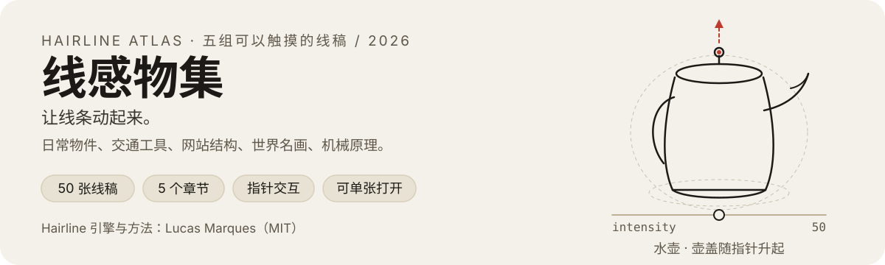
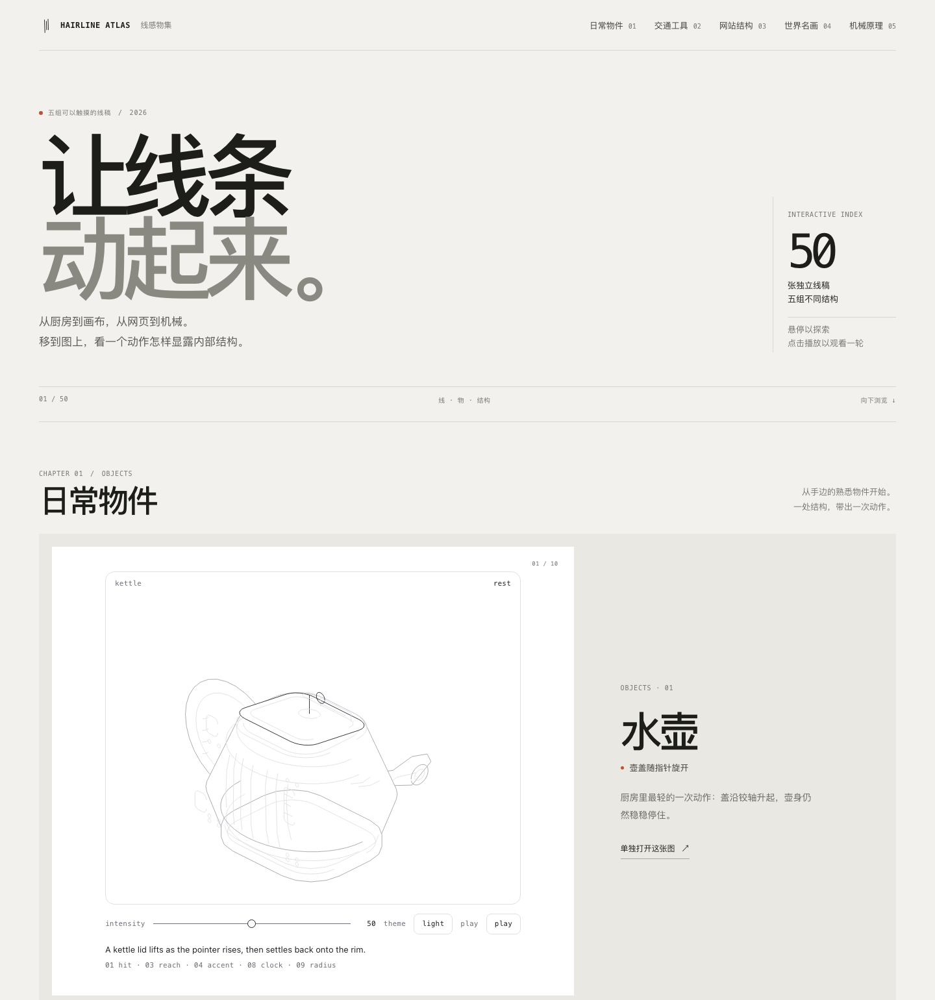

<p align="right"><a href="README.md">中文</a></p>

<p align="center">
  
</p>

<p align="center">
  <a href="https://holynova.github.io/hairline-atlas/">▶ View Online</a>
  ·
  <a href="https://github.com/holynova/hairline-atlas">GitHub Repository</a>
</p>

Fifty pointer-responsive line drawings across five chapters — everyday objects, transport, digital systems, world masterpieces, and mechanical principles. Move the pointer over a figure and its parts move: a kettle lid lifts as the pointer rises, a watch crown drives the hands. Each figure opens as a standalone interactive page.

## Screenshots

<p align="center">
  
</p>

## Five Chapters, Fifty Figures

| Chapter | The 10 figures |
| --- | --- |
| 01 Everyday Objects | Kettle, folding umbrella, camera, articulated lamp, moka pot, twin-bell alarm clock, turntable, tailor's scissors, sewing machine, mechanical wristwatch |
| 02 Transport | Bicycle, tram, sailboat, steam locomotive, helicopter, biplane, hot-air balloon, rowboat, cable car, roadster |
| 03 Digital Systems | Sitemap, server rack, route switchboard, DNS resolver, load balancer, cache hierarchy, event queue, B-tree index, auth gate, edge CDN |
| 04 World Masterpieces | Mona Lisa, Starry Night, The Great Wave off Kanagawa, Girl with a Pearl Earring, The Scream, Water Lilies, The Birth of Venus, The Kiss, The Night Watch, Las Meninas |
| 05 Mechanical Principles | Gear train, crank-slider, cam-follower, block-and-tackle, scissor jack, ratchet-pawl, rack-and-pinion, four-bar linkage, Geneva drive, screw press |

## How It Works

- **Pointer-driven motion**: move the mouse (or finger) over a figure and its parts respond to the pointer position; move away and they settle back to rest.
- **Intensity slider**: every figure has an intensity slider to set the motion range.
- **Play**: press play to watch one full motion cycle; light / dark themes switchable.
- **Standalone pages**: every figure is its own page (`figures/<name>.html`), openable, playable, and shareable on its own.
- **Masterpieces, not copies**: the masterpieces chapter starts from one signature structure in each painting and turns the composition into a touchable line sketch.

## Run Locally

Requires Node.js 20+ and Python 3. The build script assembles `figures/` and the home page into `dist/`, then serves it with a Python static server:

```bash
npm install
npm run dev
# Open http://localhost:8080
```

To edit a single figure, serve the repository root directly and open `figures/<name>.html`.

## Tech

- Each line drawing is a self-contained single-file HTML (SVG lines + pointer-driven JS motion), 50 in total under `figures/`; the home page `index.html` embeds them via iframes.
- Build: `npm run build` (`scripts/build-figures.mjs`) generates `dist/`.
- The Hairline engine and method are by Lucas Marques, MIT licensed — see the [Hairline skill](https://hairline.lucasmarkes.com/skill) and [upstream source](https://github.com/lucasmarkes/hairline).

```
index.html              Atlas home: five-chapter navigation + 50 figures embedded via iframe
styles.css              Home page styles
figures/                50 standalone line drawings (single-file HTML, openable alone)
src/                    Atlas source: index data, 9 original figure JS files, 5 chapter templates
scripts/build-figures.mjs   Build script (generates dist/)
assets/screenshot.png   Home page screenshot
```
