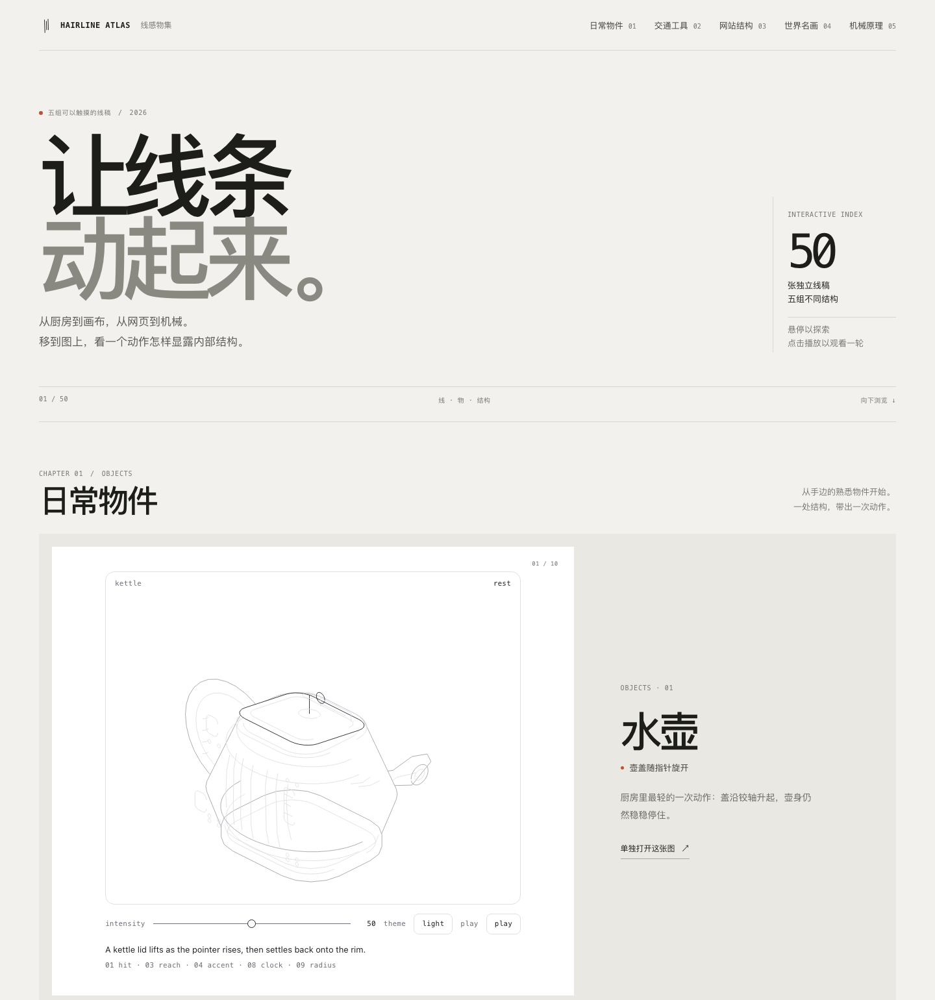

<p align="right"><a href="README.en.md">English</a></p>

<p align="center">
  
</p>

<p align="center">
  <a href="https://holynova.github.io/hairline-atlas/">▶ 在线体验</a>
  ·
  <a href="https://github.com/holynova/hairline-atlas">GitHub 仓库</a>
</p>

线感物集是五组可以触摸的互动线稿图集：日常物件、交通工具、网站结构、世界名画、机械原理各十张，共 50 张。指针移上图面，部件就跟着动——水壶盖随指针升起，表冠带动指针走时；每张作品也可单独打开与播放。

## 截图

<p align="center">
  
</p>

## 五章五十张

| 章节 | 10 张 |
| --- | --- |
| 01 日常物件 | 水壶、折伞、相机、关节台灯、摩卡壶、双铃闹钟、唱片机、裁缝剪、缝纫机、机械腕表 |
| 02 交通工具 | 自行车、有轨电车、帆船、蒸汽机车、直升机、双翼机、热气球、双桨划艇、山地缆车、敞篷跑车 |
| 03 网站结构 | 站点目录、服务器机柜、路径交换台、DNS 解析器、负载均衡器、缓存层级、事件队列、B 树索引、身份验证、边缘 CDN |
| 04 世界名画 | 《蒙娜丽莎》、《星月夜》、《神奈川冲浪里》、《戴珍珠耳环的少女》、《呐喊》、《睡莲》、《维纳斯的诞生》、《吻》、《夜巡》、《宫娥》 |
| 05 机械原理 | 齿轮传动、曲柄滑块、凸轮从动件、滑轮组、剪式千斤顶、棘轮棘爪、齿条齿轮、四杆机构、日内瓦机构、螺旋压机 |

## 玩法

- **指针触发动作**：鼠标（或触摸）移到图面上，部件随指针位置动起来；移开则回到静止态。
- **强度滑块**：每张图都有 intensity 滑块，调动作幅度。
- **播放**：点 play 看完整一轮动作；light / dark 主题可切。
- **单张打开**：每张作品都是独立页面（`figures/<name>.html`），可单独打开、播放与分享。
- **名画不复制画布**：世界名画一章从一处标志性结构出发，把构图变成可触摸的线描小景。

## 本地运行

需要 Node.js 20+ 与 Python 3。构建脚本把 `figures/` 与首页汇编到 `dist/`，再用 Python 静态服务器打开：

```bash
npm install
npm run dev
# 打开 http://localhost:8080
```

只改一张图时也可直接用静态服务器打开仓库根目录，访问 `figures/<name>.html`。

## 技术

- 每张线稿是独立的单文件 HTML（SVG 线条 + 指针驱动的 JS 动作），`figures/` 共 50 个；首页 `index.html` 用 iframe 嵌入各图。
- 构建：`npm run build`（`scripts/build-figures.mjs`）生成 `dist/`。
- Hairline 引擎与方法来自 Lucas Marques，MIT 许可，见 [Hairline skill](https://hairline.lucasmarkes.com/skill) 与[上游仓库](https://github.com/lucasmarkes/hairline)。

```
index.html              图集首页：五章导航 + 50 张图 iframe 嵌入
styles.css              首页样式
figures/                50 张独立线稿（单文件 HTML，可单独打开）
src/                    图集源码：目录数据、9 张原创图 JS、5 章模板
scripts/build-figures.mjs   构建脚本（生成 dist/）
assets/screenshot.png   首页截图
```
