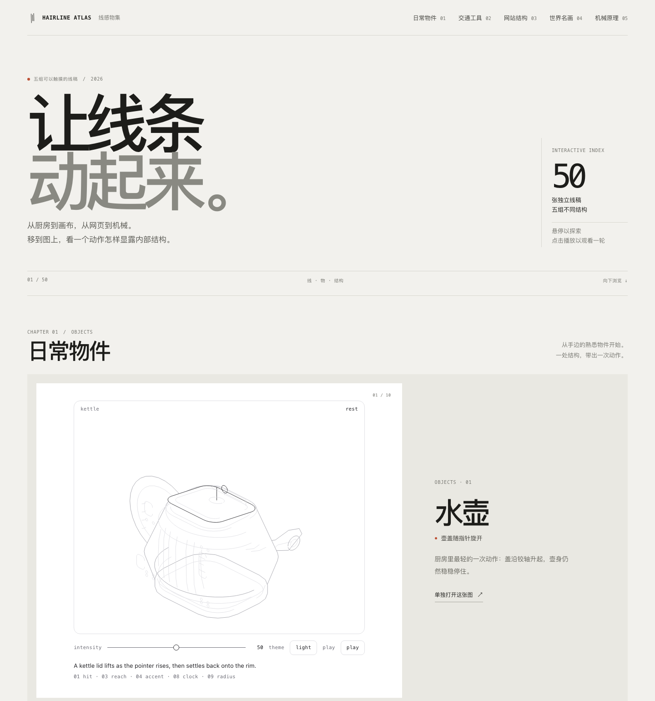

# Hairline Atlas / 线感物集

中文：五组互动线稿图集，收录日常物件、交通工具、网站结构、世界名画与机械原理各十张。指针触发部件动作，每张作品也可单独打开与播放。

English: Fifty pointer-responsive line drawings across everyday objects, transport, digital systems, world masterpieces, and mechanical principles. Each figure opens as a standalone interactive page.



## 在线体验 / Live Demo

- [Cloudflare Demo](https://xiaosang.cc/hairline-atlas/)
- [GitHub Repo](https://github.com/holynova/hairline-atlas)


## 本地运行 / Run locally

Requires Node.js 20 or later and Python 3.

```bash
npm install
npm run dev
```

## 构建与发布 / Build and deploy

```bash
npm run build
npm run deploy:check
npm run deploy
```

Cloudflare Worker: `hairline-atlas` · Domain: `xiaosang.cc` · Route: `/hairline-atlas/`.

The Hairline figure engine and method are by Lucas Marques, used under the included MIT license. See [the Hairline skill](https://hairline.lucasmarkes.com/skill) and [upstream source](https://github.com/lucasmarkes/hairline).
